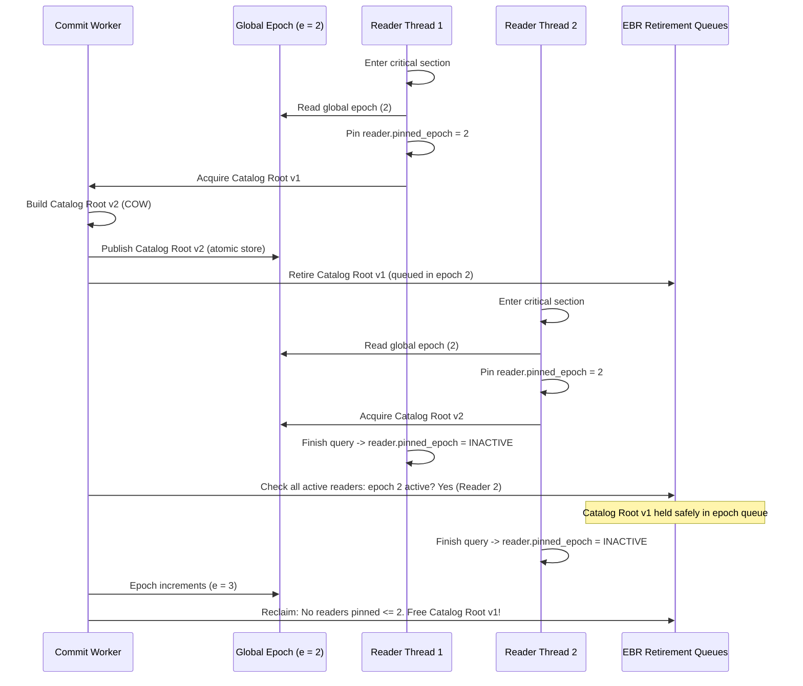
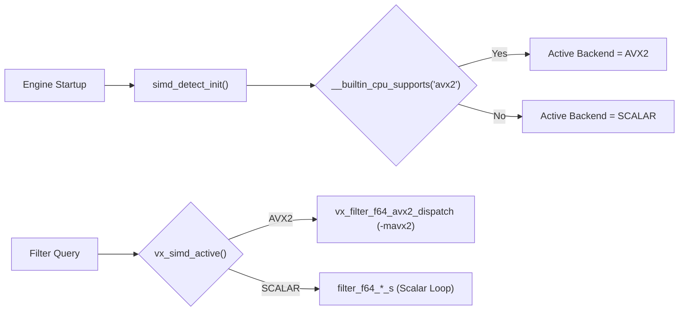

# Vex Engine Architecture

This document details the internal systems architecture of the **Vex** columnar database engine.

---

## 1. Columnar Storage & Memory Layout

Vex structures tabular data in vertically partitioned columnar arrays grouped into fixed-size horizontal chunks.

### 1.1 Chunk Representation (`vx_chunk_t`)

Tables are divided into sequential immutable chunks containing up to $N$ rows (default: 4,096 rows). Each chunk holds independent vectors for each schema column:

```text
+---------------------------------------------------------------------------------+
|                                   vx_chunk_t                                    |
+---------------------------------------------------------------------------------+
| chunk_id: 101 | nrows: 4096 | cap: 4096 | str_arena (64KB - 16MB)                |
+---------------------------------------------------------------------------------+
|  Col 0: u64 (id)       | [ 1,   2,   3,  ..., 4096 ]       (64-byte aligned)    |
|  Col 1: str (name)     | [ vx_str_t x 4096 ]              (16-byte German str) |
|  Col 2: f64 (price)    | [ 19.5, 22.0, ..., 99.0 ]        (64-byte aligned)    |
|  Col 3: bool (active)  | [ 1,   1,   0,  ..., 1 ]          (byte-packed)        |
+---------------------------------------------------------------------------------+
|  Zone Maps: Col 0 [1, 4096] | Col 2 [19.5, 99.0]                                |
|  Null Bitsets: 64-bit word bitmaps per column                                    |
+---------------------------------------------------------------------------------+
```

### 1.2 64-Byte Cacheline Alignment

Every numerical and string column array is allocated with `posix_memalign` aligned to 64 bytes (`VX_COL_ALIGN`):
* Prevents split-cacheline penalties during sequential memory scans.
* Enables unaligned and aligned vector loads (`_mm256_loadu_pd`, `_mm256_load_pd`) to execute without page-boundary crossing stalls.
* Eliminates False Sharing when multi-threaded workers read contiguous columnar slices concurrently.

### 1.3 Zone Maps ($O(1)$ Chunk Pruning)

Each column vector maintains a `vx_zone_map_t` tracking the minimum and maximum values present in that chunk:
* Before scanning rows in a chunk for predicates like `price > 100.0`, the execution engine compares the predicate value against the zone map.
* If `100.0 > zone.max.f64`, the entire chunk is skipped without inspecting individual rows, bypassing CPU cache pollution.
* For string columns, zone maps compare 8-byte prefix integers for immediate preliminary pruning.

### 1.4 Umbra-Style German String Layout (`vx_str_t`)

Strings are stored using a 16-byte value-type structure modeled after the German string format popularized by modern research engines:

```c
typedef struct {
    uint32_t len;
    union {
        char inline_data[12];
        struct {
            char     prefix[4];
            uint32_t offset;
            char    *ptr;
        } out_of_line;
    } u;
} vx_str_t;
```

* **Short Strings ($\le 12$ bytes)**: The payload is copied directly into `inline_data`. No heap allocation occurs, producing zero heap fragmentation and maximum cacheline utilization.
* **Long Strings ($> 12$ bytes)**: The first 4 bytes are copied into `prefix`, and the remainder is appended to the chunk's `vx_arena_t`. Equality checks and string comparisons test the 4-byte prefix first; if the prefixes do not match, the out-of-line payload pointer is never dereferenced.

---

## 2. Lock-Free Concurrency & MVCC (EBR)

Vex provides full ACID snapshot isolation for read queries without blocking write mutations, and without using locks on the read path.

### 2.1 Epoch-Based Reclamation (`vx_ebr_t`)

To avoid Use-After-Free (UAF) bugs while allowing background memory freeing of retired catalog roots, chunks, and indexes, Vex implements an Epoch-Based Reclamation system.



### 2.2 Reader Slot Lifecycle & TLS Recycling

When high-frequency ephemeral threads query the engine, creating and destroying reader handles naively would cause thread pool starvation. Vex solves this with lock-free slot recycling:
1. `vx_ebr_register_reader`: Scans the fixed reader array using atomic compare-and-swap (`atomic_compare_exchange_strong_explicit` on `in_use`).
2. When a thread terminates, a `pthread_key_create` destructor calls `vx_ebr_unregister_reader`, resetting `pinned_epoch` to `VX_EBR_INACTIVE` with `memory_order_seq_cst` and clearing `in_use`.

---

## 3. The Write Path: Micro-Batch SPSC Write Mesh

To achieve millions of sustained inserts per second without global write-lock contention, write operations route through a Single-Producer Single-Consumer (SPSC) write mesh (`vx_wmesh_t`).

```text
+-------------------+        +--------------------------------+
| Client Thread 1   | -----> | SPSC Ring Buffer 0 (_Alignas)  | \
+-------------------+        +--------------------------------+  \
                                                                  \   +----------------------+
+-------------------+        +--------------------------------+    -> | Micro-Batch Commit   |
| Client Thread 2   | -----> | SPSC Ring Buffer 1 (_Alignas)  | ----> | Worker (Appends WAL, |
+-------------------+        +--------------------------------+    -> | Updates PK Index,    |
                                                                  /   | Publishes New Root)  |
+-------------------+        +--------------------------------+  /    +----------------------+
| Client Thread N   | -----> | SPSC Ring Buffer N (_Alignas)  | /
+-------------------+        +--------------------------------+
```

### 3.1 Ring Buffer Design
* Each thread maintains its own ring buffer allocated with cacheline padding `_Alignas(64)` between `head` and `tail` pointers to avoid multi-core false sharing.
* `vx_wmesh_submit` is completely wait-free for producers as long as capacity remains in the ring buffer.

### 3.2 Hybrid Triggering
The background commit worker polls registered rings and flushes batches based on two thresholds:
1. **Count-based**: Batch fills to `batch_max_ops` (e.g., 1,024 mutations).
2. **Latency-based**: Timeout threshold (`flush_interval_us`, default 2,000 µs) expires.

---

## 4. Primary Key Index & COW Deletions

Vex features $O(1)$ point lookups, updates, and deletes via a Robin Hood hash table and Copy-On-Write deletion bitmasks.

### 4.1 128-Way Sharded Robin Hood Index (`vx_rhmap_t`)

Rather than indexing table keys in a single massive hash table that would require expensive whole-table copies on COW mutations, the primary key index is partitioned across 128 independent shards:
* **Shard Selection**: Calculated as `shard = rh_hash(key) % 128`.
* **Probe Sequence Length (PSL)**: Tracks displacement from the ideal home hash bucket. When inserting a displaced key with higher PSL than the current occupant, the insertion swaps and displaces the existing key ("rich steal from the poor"), minimizing probe length variance.
* **Zero Sentinel Restrictions**: `psl == 0` signifies an empty slot, while `psl >= 1` represents an occupied slot. Consequently, all 64-bit integer values (including `0` and `UINT64_MAX`) are valid keys.
* **Packed Row Coordinates**: The index stores values packed as:
  $$\text{packed} = (\text{chunk\_idx} \ll 32) \mid \text{row\_idx}$$

### 4.2 Copy-On-Write Deletion Maps (`vx_delmap_t`)

When rows are deleted or updated:
1. Physical rows are not shifted or deleted in place (which would invalidate parallel reader scans).
2. A bit is set in the chunk's refcounted deletion bitmask (`vx_delmap_set`).
3. If an existing chunk's refcount is greater than 1, a lightweight clone of the deletion map is produced via Copy-On-Write.
4. During queries, morsel readers skip rows where `vx_delmap_is_set(dm, r)` returns `true`.

---

## 5. Runtime SIMD Dispatch Architecture

Vex compiles vectorized analytical execution kernels without sacrificing portability across x86_64, aarch64, or older CPUs.



### 5.1 The AVX2 Packed Comparison Kernel
In `src/vx_simd_avx2.c`, float filter operations load 4 64-bit doubles into 256-bit registers (`_mm256_loadu_pd`), compare them against the broadcasted comparison operand (`_mm256_cmp_pd`), extract the 4-bit comparison mask (`_mm256_movemask_pd`), and write matching row offsets into output selection arrays using a precomputed 16-entry lookup table (`k_avx2_lut4`).

---

## 6. Durability, Checkpointing & File Locking

### 6.1 CRC32 Write-Ahead Log (`vx_wal_t`)
Every mutation committed by the write mesh writes a serialized binary record to the append-only `.wal` file before updating the in-memory catalog:
* **Header**: 16 bytes containing magic (`VXWAL001`), version, and reserved fields.
* **Record Header**: 28 bytes containing record magic (`VXR`), transaction ID, LSN, operation type, payload length, and payload CRC32.
* **Crash Recovery**: If the host experiences an ungraceful shutdown or power loss, `vx_wal_replay` reads records sequentially, validating CRC32 checksums. If a torn write occurs at the end of the log, recovery truncates the file back to the last valid byte offset.

### 6.2 Atomic Snapshot Checkpointing (`vx_snap.c`)
Over time, the WAL accumulates historical operations and tombstones. Invoking `db.checkpoint()` triggers atomic compaction:
1. **Catalog Export**: Live rows (excluding rows marked in deletion maps) are streamed into a contiguous buffer with header magic `VXSNAP01` and IEEE CRC32 checksums.
2. **Two-Phase Commit File I/O**:
   - The buffer is written to `<wal_path>.snap.tmp`.
   - `fdatasync()` forces bytes to non-volatile physical storage.
   - POSIX `rename()` atomically replaces `<wal_path>.snap`.
   - `fsync()` on the parent directory ensures directory inode durability.
3. **Log Truncation**: `vx_wal_reset` truncates the `.wal` file back to 16 bytes while preserving strict LSN monotonicity.

### 6.3 Exclusive OS Process Locking (`flock`)
To guarantee that two independent operating system processes do not attempt to open the same database file concurrently, `vx_wal_open` acquires an advisory exclusive kernel lock:
```c
if (flock(fd, LOCK_EX | LOCK_NB) != 0) {
    close(fd);
    return NULL;
}
```
Any competing process attempting to open the same database path immediately fails with `VexError`.

